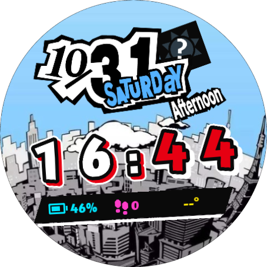
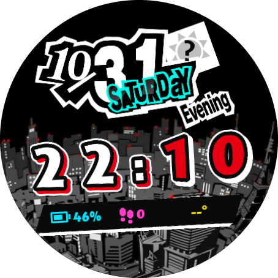

# Persona 5 Watch Face

A Persona 5 inspired watch face for Wear OS, built with the
[Watch Face Format](https://developer.android.com/training/wearables/wff). It recreates the game's
layered calendar on a city skyline, with a light theme by day and a dark theme by night.

## Screenshots

<p>
  
  
</p>

The light theme runs from 06:00 to 18:00 and the dark theme from 18:00 to 06:00.

*Captured on the Wear OS emulator, which has no forecast or step sensor. That is why the weather tag
shows "?" and the temperature and step count are empty or zero.*

## Features

- Layered date, month and weekday stickers, drawn in the same order as the game
- 24-hour two-colour clock with white hours and red minutes
- Time of day art, such as "Early Morning", "Afternoon" and "Evening"
- Weather icon and temperature, with a "?" tag while no forecast is available
- Battery and step count
- Low-power always-on mode that shows only the clock outline and date

## Requirements

- A round watch or emulator on Wear OS 5 or later (API 34+)
- Android Studio, or the Android SDK and a JDK
- Python 3 with [Pillow](https://python-pillow.org/), only for regenerating the face

## Build and install

```sh
./gradlew :watchface:assembleDebug
adb install -r watchface/build/outputs/apk/debug/watchface-debug.apk
```

Then long-press the current watch face on the device and choose **Persona 5 Watch Face**.

## Changing the design

`watchface/src/main/res/raw/watchface.xml` and the `p5_*` drawables are generated, so edit
`tools/generate_watchface.py` rather than those files. Layout values such as `CLOCK_Y` and
`TOD_X` are at the top of the script.

The script reads the calendar art from a clone of the assets repository, which it expects next to this
project. Pass a path to use a different location.

```sh
pip install pillow
python3 tools/generate_watchface.py [path/to/Persona-5-Calendar]
```

The script stops with an error if any calendar art would be clipped by the round display.

## Project layout

```text
tools/generate_watchface.py   Generates the drawables and watchface.xml
tools/source/                 Original background images
watchface/src/main/res/       Watch face resources
docs/                         README screenshots
```

## Credits

- Calendar, time of day and weather art comes from
  [Mive82/Persona-5-Calendar](https://github.com/Mive82/Persona-5-Calendar), a Rainmeter skin by Mive
  released under the WTFPL. That skin credits Reddit user BHDown for remaking the calendar vector
  graphics and DeviantArt user Dartemil for the original Persona 5 Calendar skin.
- Persona 5 and its related artwork belong to Atlus and Sega. This is an unofficial fan project and
  is not affiliated with or endorsed by them.
